# Balloon Game

Jogo de balão feito com HTML, CSS e JavaScript puro, sem bibliotecas nem bundler.
Desvie de nuvens de tempestade e pássaros, junte moedas e power-ups e chegue o mais
longe possível, sozinho, com alguém no mesmo teclado ou online.

<p align="center">
  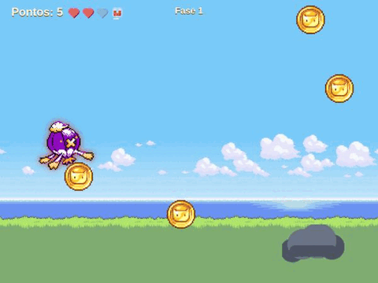
</p>

## Como jogar

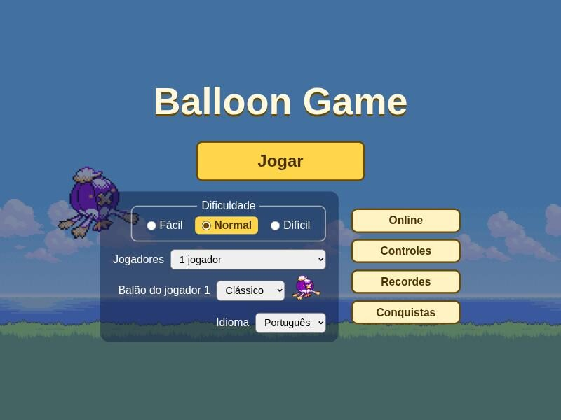

1. No menu, escolha a dificuldade, quantos jogadores, o balão de cada um e o idioma.
2. Clique em **Jogar**. O cenário rola sozinho; você só move o balão.
3. Pegue moedas para somar pontos e bolhas de power-up para ganhar vantagens.
4. Desvie das nuvens de tempestade e dos pássaros: cada batida custa uma vida.
5. Quanto mais longe, mais rápido fica. A partida termina quando todos ficam sem vidas.

<br clear="right">

## Obstáculos, vidas e power-ups

<p align="center">
  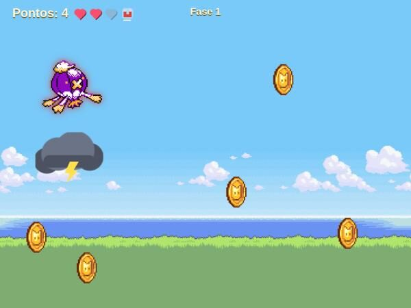
</p>

| Power-up | Efeito | Duração |
| --- | --- | --- |
| Escudo | Absorve a próxima batida | Até ser usado |
| Ímã | Puxa as moedas próximas | 8 s |
| Moedas em dobro | Cada moeda vale 2 pontos | 10 s |

| Dificuldade | Vidas | Velocidade | Obstáculos |
| --- | --- | --- | --- |
| Fácil | 5 | 80% | 70% |
| Normal | 3 | 100% | 100% |
| Difícil | 2 | 130% | 140% |

Depois de uma batida o balão pisca e fica alguns instantes invulnerável. Os efeitos
ativos aparecem no HUD, ao lado das vidas.

## Fases

O céu muda conforme a distância percorrida, e cada fase deixa o jogo mais rápido.

| Fase | Começa em | Velocidade extra |
| --- | --- | --- |
| 1. Dia | 0 m | — |
| 2. Pôr do sol | 500 m | +10% |
| 3. Noite | 1200 m | +20% |
| 4. Tempestade | 2000 m | +35% |

<p align="center">
  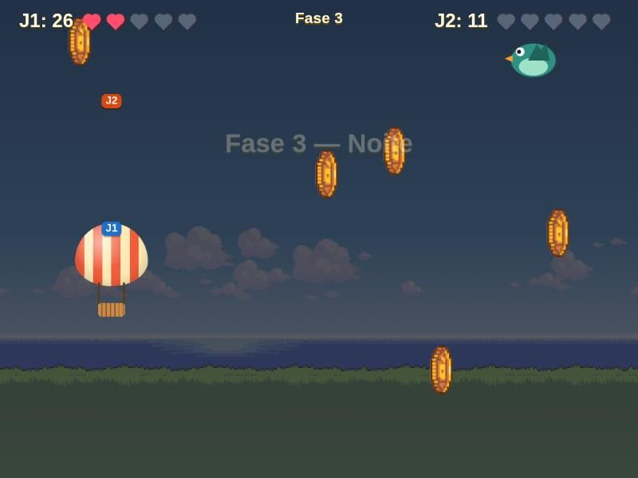
  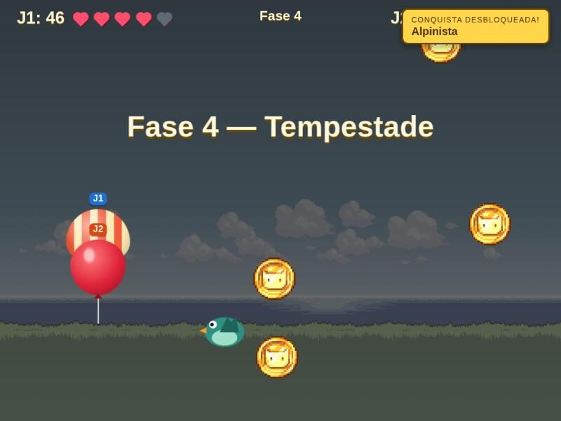
</p>

## Balões

<p align="center">
  
</p>

Clássico, festa, ar quente, coração e estrela. Cada jogador escolhe o seu no menu;
os quatro novos são desenhados só com CSS.

## Dois jogadores no mesmo teclado

Escolha **2 jogadores** no menu: o jogador 1 usa as setas e o jogador 2 usa W A S D.
Cada um tem seu placar e suas vidas, e a partida só acaba quando os dois caem.

<p align="center">
  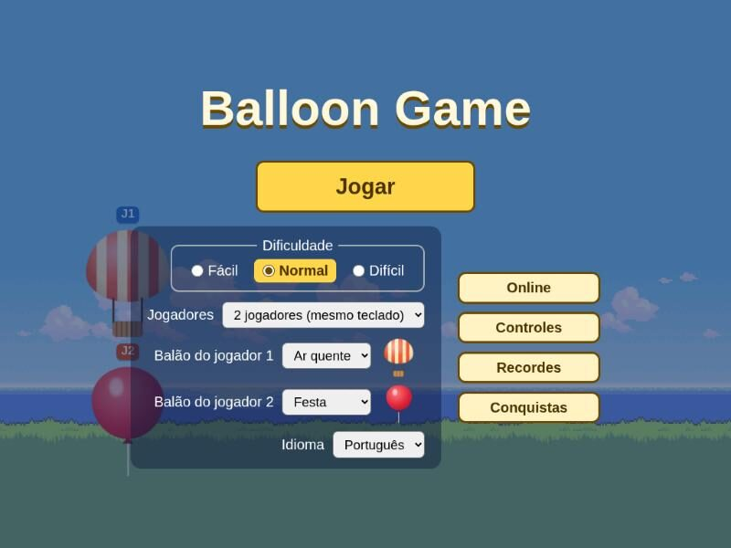
  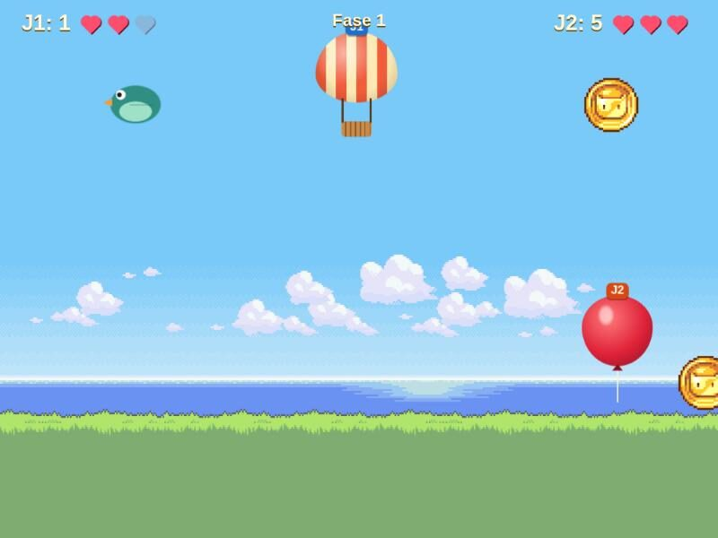
</p>

## Recordes e conquistas

No fim da partida aparecem os pontos de cada jogador, a distância percorrida e o
aviso de novo recorde. Os cinco melhores resultados, as estatísticas e as 10
conquistas ficam salvos no navegador.

<p align="center">
  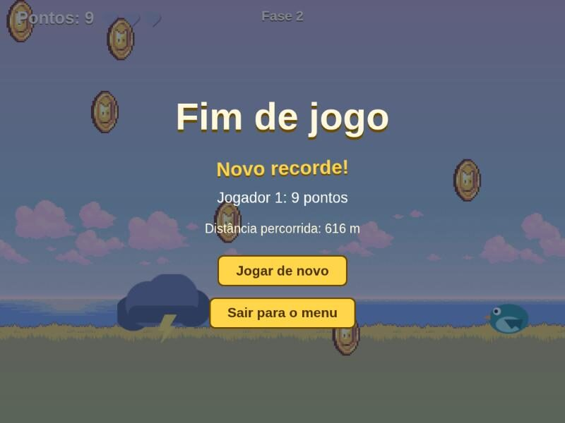
  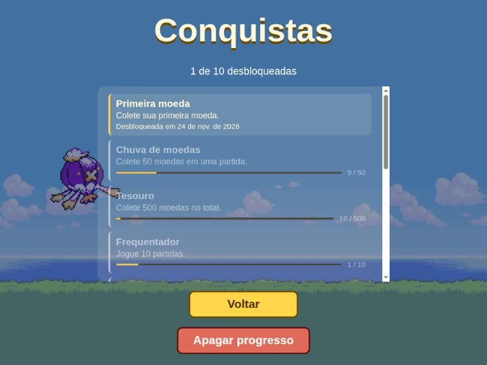
</p>

## Funcionalidades

- **Fases**: dia, pôr do sol, noite e tempestade, cada uma mais rápida que a anterior.
- **Dificuldades**: fácil, normal e difícil (velocidade, frequência de obstáculos e vidas).
- **Obstáculos e vidas**: nuvens de tempestade e pássaros tiram vidas; o balão pisca
  enquanto está invulnerável.
- **Power-ups**: escudo, ímã de moedas e moedas em dobro.
- **Balões**: clássico, festa, balão de ar quente, coração e estrela.
- **Multijogador local**: dois jogadores no mesmo teclado.
- **Multijogador online**: dois navegadores conectados por WebRTC, sem servidor.
- **Teclas configuráveis** para cada jogador.
- **Recordes, estatísticas e conquistas** salvos no navegador.
- **Idiomas**: português, inglês, espanhol e francês.

## Como rodar

O jogo usa ES modules, então precisa ser servido por HTTP (abrir o `index.html`
direto pelo sistema de arquivos não funciona).

```bash
npm start
```

Depois abra <http://localhost:8080>. O script usa `python3 -m http.server`; qualquer
servidor estático serve.

## Controles

| Ação | Jogador 1 | Jogador 2 |
| --- | --- | --- |
| Mover | Setas | W A S D |
| Pausar / continuar | Esc ou P | Esc ou P |

As teclas podem ser trocadas em **Controles**, no menu principal: clique em
**Alterar** e aperte a nova tecla. Esc e P ficam reservadas para a pausa.

<p align="center">
  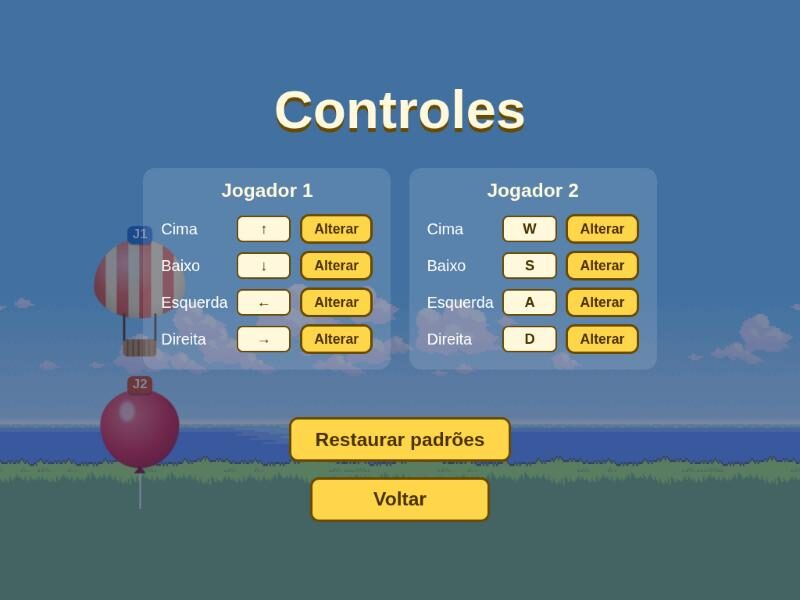
</p>

## Jogando online

A conexão é ponto a ponto (WebRTC). Não existe servidor do jogo: os dois jogadores
trocam códigos manualmente, por qualquer mensageiro.

1. Quem hospeda clica em **Online → Criar partida** e envia o código gerado.
2. Quem entra clica em **Online → Entrar em partida**, cola o código, clica em
   **Conectar** e devolve o código de resposta.
3. Quem hospeda cola a resposta, clica em **Conectar** e depois em **Iniciar partida**.

A partida roda no navegador de quem hospeda; o outro navegador envia só os comandos
e recebe o estado do jogo. Pausar de um lado pausa os dois, e trocar de aba também
pausa a partida. Redes muito restritivas
(alguns NATs corporativos) podem impedir a conexão, porque o jogo usa apenas STUN.

## Estrutura do projeto

```
index.html        telas e HUD
css/              estilos por funcionalidade
src/main.js       ponto de entrada, monta as dependências
src/app.js        fluxo de telas
src/core/         loop, teclado, eventos, armazenamento
src/entities/     balão, moedas, obstáculos, power-ups
src/game/         regras da partida e sistemas
src/progression/  dificuldade e fases
src/progress/     estatísticas, recordes e conquistas
src/multiplayer/  multijogador local, skins e controles
src/net/          multijogador online
src/i18n/         traduções
tests/            testes unitários
```

Os detalhes de arquitetura estão em [docs/architecture.md](docs/architecture.md).

## Testes

```bash
npm test
```

Usa o test runner nativo do Node (`node --test`), sem dependências.

## Contribuindo

Veja [CONTRIBUTING.md](CONTRIBUTING.md).

## Versões anteriores

V1:


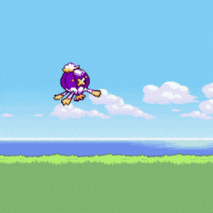

V2:


V3:


