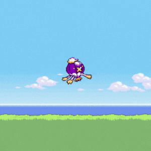

# Balloon Game

Jogo de balão feito com HTML, CSS e JavaScript puro, sem bibliotecas nem bundler.
Desvie de nuvens de tempestade e pássaros, junte moedas e power-ups e chegue o mais
longe possível, sozinho, com alguém no mesmo teclado ou online.

## Funcionalidades

- **Fases**: dia, pôr do sol, noite e tempestade, cada uma mais rápida que a anterior.
- **Dificuldades**: fácil, normal e difícil (velocidade, frequência de obstáculos e vidas).
- **Obstáculos e vidas**: nuvens de tempestade e pássaros tiram vidas; o balão pisca
  enquanto está invulnerável.
- **Power-ups**: escudo, ímã de moedas e moedas em dobro.
- **Balões**: clássico, festa, balão de ar quente, coração e estrela.
- **Multijogador local**: dois jogadores no mesmo teclado.
- **Multijogador online**: dois navegadores conectados por WebRTC, sem servidor.
- **Teclas configuráveis** para cada jogador.
- **Recordes, estatísticas e conquistas** salvos no navegador.
- **Idiomas**: português, inglês e espanhol.

## Versões anteriores

V1:

V2:

V3:

